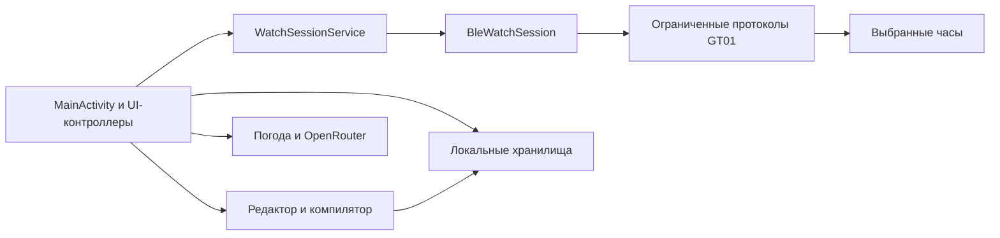

# Руководство разработчика

Документ описывает публичную копию 1.0.0. Прочитайте [ограничения](KNOWN_LIMITATIONS.md) и [сборку](BUILDING.md). Протокол основан на известных путях GT01; проект не имеет общей спецификации производителя для любых часов.

## Карта репозитория

```text
android/
  app/build.gradle.kts               версии, SDK, зависимости, подпись
  app/src/main/AndroidManifest.xml   разрешения, Activity, services, FileProvider
  app/src/main/java/app/gtdial/lab/   весь прикладной Java-код
  app/src/main/res/                  темы, строки, launcher, XML Android
  app/src/main/assets/
    dynamic_dials/                  пакеты, предпросмотры и реестры галереи
    dial_editor/                    закреплённый шаблон и композиции редактора
  gradle/wrapper/                    закреплённый wrapper
tools/                              автономный анализ и обработка ресурсов
docs/images/user-guide/             обезличенные снимки интерфейса
```


## Архитектура приложения

Приложение написано на Java. Интерфейс создаётся нативными Android View и контроллерами; отдельной React/WebView/frontend-сборки нет. `MainActivity` объединяет верхний уровень навигации, галерею, подключение и дополнительные экраны. `UiKit`, `UiIcons`, `UiText`, `AppPreferences` задают общие элементы, язык и четыре темы (`default`, `midnight-blue`, `arctic`, `olive`).



`WatchSessionService` удерживает сеанс Bluetooth независимо от пересоздания Activity и сообщает состояние через binder/callbacks. `BleWatchSession` владеет GATT, MTU, serial обработкой запросов и маршрутизацией входящих кадров. UI не должен отправлять произвольные байты напрямую и не должен объявлять устройство готовым только потому, что GATT подключён.

| Ответственность | Главные файлы в `android/app/src/main/java/app/gtdial/lab/` |
| --- | --- |
| Соединение и состояние | `WatchSessionService`, `BleWatchSession`, `ConnectionSnapshot`, `SessionRecoveryPolicy` |
| Базовые известные RPC и диагностика | `McfProtocolProbe`, `AlbumStageProtocol` |
| Встроенная галерея | `BundledDynamicDialRepository`, `BundledDynamicDial`, `DynamicDialPackage` |
| Пользовательский редактор | `DialEditorController`, `DialEditorView`, `DialEditorGeometry`, `DialCanvasTransform`, `DialRuntimeProfile`, `DialProject` |
| Ревизии, импорт и нормализация | `DialProjectRepository`, `DialProjectArchive`, `DialImageNormalizer` |
| Компиляция и проверка | `Gt01DialCompiler`, `Gt01DialValidator`, `Gt01DialContainerCodec`, `Gt01PlbCodec`, `Gt01PgfCodec`, `CompiledDialArtifactStore` |
| Старые квитанции/резервирование | `DynamicDialOwnershipStore`, `DynamicDialBackupStore`, `DynamicDialAuthorization` |
| Ход установки | `DialInstallProgress`, `DialInstallJournal` |
| Активность и автосинхронизация | `ActivityPollController`, `ActivitySnapshot`, `ActivityHistoryStore`, `OrdinarySyncController` |
| История здоровья | `TsdbReadProtocol`, `UbjsonCodec`, `LauncherEnvelopeCodec`, `HealthHistoryParser`, `HealthDatasetParser`, `HealthEvidenceImporter` |
| Уведомления | `NotificationForwardingService`, `NotificationForwardingPolicy`, `NotificationSessionBridge`, `NotificationSessionProtocol`, `NotificationProtocol` |
| Погода | `PhoneWeatherController`, `WeatherRefreshController`, `WeatherDeliveryController`, `WeatherSessionProtocol`, `WeatherPayload`, провайдеры |
| Локальная общая база | `ExpansionStore`, `ExpansionModels`, `ExpansionUiController` |
| Тренировки | `WorkoutRecorder`, `PhoneWorkoutService`, `WorkoutCatalog`, `WorkoutTypeDictionary` |
| Силовой дневник | `StrengthDiary`, `StrengthCatalog`, `StrengthProgress`, `StrengthUiController` |
| Питание | `NutritionDiary`, `NutritionModels`, `NutritionArchive`, `NutritionUiController`, `NutritionSummary`, `FoodSearchController` |
| Фото еды | `NutritionImagePreparer`, `NutritionPhotoController` |
| Анализ | `AnalysisSnapshot`, `AnalysisController`, `AnalysisResponseValidator`, `AnalysisUiController` |
| OpenRouter | `OpenRouterClient`, `OpenRouterModelCatalog`, `OpenRouterCredentialStore` |
| Отчёты и диагностика | `ReportExporter`, `OperationJournal`, `DiagnosticFiles`, `DiagnosticLog`, `WatchBackup` |
| Закрытые кандидаты | `DeviceFeatureGate`, `AlarmProtocol`, `AlarmTransferPlan`, `AlarmEditorUi`, `AndroidAlarmBridge` |

Перед правкой прочитайте реальный путь вызова. Старый класс с подходящим именем может не обслуживать текущий пользовательский сценарий. В частности, наличие `DynamicDialInstallProtocol` не означает, что обычная кнопка работает через его исторический preflight/readback: действующая прямая установка идёт через `AlbumStageProtocol.directInstall`.

## Состояние, конкуренция и lifecycle

- У протокольного запроса один ожидаемый ответ и ограниченное ожидание. Операции не запускаются параллельно поверх одного сеанса.
- Callback должен проверять, что Activity/контроллер ещё жив, generation/session соответствуют запросу, а выбранный объект не изменился.
- Прогресс отражает подтверждённое состояние и количество переданных байтов, а не воображаемую скорость или таймер успеха.
- Разрешение восстановления обычного соединения не даёт права повторить неуспешную команду записи.
- После terminal failure нельзя автоматически отправлять install/apply/delete/reset как «исправление». Новое явное действие пользователя — новая операция.
- Перерисовка не должна стирать ввод, возвращать чужую страницу, сбрасывать scroll/focus или лишний раз читать часы.
- Background location запускается видимым действием пользователя и foreground service, а не произвольным callback восстановления Bluetooth.

### Восстановление соединения в 1.0.1

`RECONNECT_WAIT` сохраняет ожидание только для выбранного проверенного адреса. Обычная ошибка чтения или временный сбой setup блокирует старую GATT, сохраняет ожидание и закрывает соединение после выхода из callback; следующая попытка создаёт новую GATT. IDLE сохраняется после успешной подписки CCCD. Ручное отключение, ошибка сохранения состояния, несовпадение устройства и защищённые записи сохраняют STOPPED. Перезапуск не должен превращать OPERATION/NOTIFICATION с неизвестной фазой в повтор отправки.

TSDB разбирает ограниченный поток кадров: валидные входящие REQ и чужие RSP/ACK игнорируются без продления deadline. Коррелированный ответ строго проверяется, дубликаты и повреждённые кадры завершают чтение. Сохранение страницы принимается один раз; успешное доказательство содержит только точный принятый RSP.

Для уведомлений восстановление разрешено лишь при транспортной ошибке этапа PUSH после подтверждения настройки. Уведомление удаляется из очереди и не повторяется; ошибки настройки и её проверки остаются остановкой.

## Обычная установка циферблата

Текущий путь поддерживает выбранный встроенный или проверенный LOCAL-пакет:

```text
готовность/известный handshake
→ open фиксированного download target
→ write подтверждаемыми частями
→ close
→ svc_dial_install(path, alias)
→ svc_dial_apply(alias)
→ svc_dial_get_current
→ проверка выбранного id/alias
→ terminal success
```

Точный target текущей реализации — `/download/1909202601.dial`; имя файла не является идентичностью устанавливаемой модели. Каждая часть write требует точного подтверждённого количества, close/install/apply — ожидаемого успешного результата. `svc_dial_get_current` может вернуть идентичность пакета либо alias; она должна совпасть с выбранным target.

Прямой путь не создаёт новую backup, не перечитывает файл, не меняет ownership и не требует прежней receipt. Это действующая политика, которую нельзя заменить историческими воротами без нового запроса. Сохранённые старые материалы не удаляются ради ускорения. Фактический риск: успешные ответы и current проверяют протокольный результат, но не доказывают побайтовую целостность всего удалённого пакета.

При отказе Android TX, короткой записи, неожиданном ответе, timeout, disconnect или неправильном current операция заканчивается. Неизвестный частичный файл остаётся предметом анализа, а не автоматической очистки. Не расширяйте target, команды или MTU-ограничения по предположению. Этот установленный путь не открывает произвольную удалённую файловую систему.

## Протокольные слои

### MCF и D2D

Наблюдаемый внешний frame:

```text
FC | length uint16 BE | frameId byte | reserved byte | payload | CRC16 BE | CF
```

Общая длина — `payload.length + 8`. CRC рассчитывается по байтам начиная с поля длины до конца payload: начальное `0xFFFF`, полином отражённого расчёта `0xA001`, затем сохраняется старший байт перед младшим. Это конкретная реализация `McfProtocolProbe.frame`, а не повод игнорировать проверки других принимающих классов.

D2D-запрос этого пути начинается `[1, 0, 1, packetId, 0x10]`: transport D2D, phone/server DID, watch daemon DID, ID запроса, REQ с необходимым ответом без отдельного ACK. ID frame и ID packet — разные счётчики. Для принятия ответа важны источник/назначение, тип, ID, размер, CRC и текущая стадия; поздние/чужие/дублирующиеся кадры не должны продвигать другую операцию.

uRPC service кодируется как имя UTF-8 + NUL + байт `1` + известные аргументы. FFI-обёртки допускают только заранее проверенные функции/схемы. Наличие универсального кодировщика не является разрешением универсального UI «отправить FFI».

### UBJSON и launcher

`UbjsonCodec` ограничивает сообщение 32 КиБ, проверяет типы, длины, вложенность и отсутствие лишнего хвоста. Внешний launcher envelope использует `from`, `to`, `body.tag="message"`, `content.app`, `total`, `msg`, `index`, `timestamp`. Входящий адресат должен быть `local.control`; допустимые источники проверяет `LauncherEnvelopeCodec`.

Reassembler связывает timestamp/total и требует последовательный cumulative `index`, который увеличивается на длину текущей части. Внутренний UTF-8 JSON имеет `intent`, `data`, `taskId`; response проверяется по ожидаемым task/intent. Сведения о структуре не позволяют угадывать новый `intent` или путь TSDB.

### Известные TSDB-профили

`TsdbReadProtocol.Profile` содержит:

| Профиль | Точный путь | Граница |
| --- | --- | --- |
| `SLEEP_PAGE` | `/data/share/system/activity_sleep` | Ограниченное продолжение страниц сна; сохранение страницы подтверждается перед следующим запросом. |
| `SPO2_PAGE` | `/data/share/system/activity_spo2` | Существующий ограниченный профиль, без произвольного выбора dataset. |
| `HEART_LAST` | `/data/share/system/activity_heartRate` | Последнее сохранённое наблюдение. |
| `SPORTS_PAGE` | `/data/share/system/sports_record` | Экспериментальный, закрыт `DeviceFeatureGate.NONE`. |

Пути присутствуют в реализации; это не утверждение полной живой проверки каждого профиля. Ошибки разбора не превращайте в фиктивные значения. Для сна нужны порядок интервалов и конечная граница, для пагинации — контроль повторных страниц/записей и суммарного лимита. Неизвестные масштабы спорт-полей остаются raw.

### Уведомления

`NotificationProtocol` использует известный `svc_notification_push`: заголовок, пустое поле, mapped sender, текст, пустое поле, `TextMsg`, `NoPrompt`, `u32(1)`, `u32(epochSeconds)`. Строки NUL-terminated внутри ограниченного array-аргумента; время ограничено uint32. Не заменяйте `TextMsg` произвольными командными типами.

Передача принимает только выбранные пакеты и новые ограниченные сообщения. Очередь/срок/дедупликация и ограничения UTF-8 описаны в [PRIVACY.md](PRIVACY.md). Текст уведомления не должен входить в лог.

## Локальные данные

`ExpansionStore` — SQLite helper `chasovoy_local.db`, schema version 4, один process executor, foreign keys включены. Отдельное хранилище накопленных наблюдений активности сохраняет свою ответственность; его нельзя молча мигрировать в другую семантику.

Главные группы таблиц: `health_records`, `health_details`, `imports`, `workouts`, `workout_laps`, `workout_locations`, `plans`, `manual_entries`, `alarm_drafts`, `hidden_insights`, `local_settings`, силовой дневник, `nutrition_foods`, `nutrition_entries`, `nutrition_days`, `analysis_reports`. Многие модели содержат версионируемый `data_json`; точная схема — в модели/валидаторе, а не в подписи карточки.

Миграции 1→2→3→4 аддитивные. Ошибка открытия или неподдерживаемая версия не должна инициировать уничтожение базы/повторное создание. Импорт сначала проверяет весь ограниченный документ, затем применяет атомарную транзакцию. Совпавшая идентичность с другими данными — конфликт, а не повод молча переписать запись.

История здоровья хранит device/dataset/timestamp/raw SHA/evidence, время получения, зону, validity и coverage. Уникальность включает источник и хеш. Пустое, неподдерживаемое, частичное и недоступное состояния сохраняйте различными. Дневной график строится по реальным наблюдениям, не искусственно сглаженным дням или нулям вместо отсутствия.

Пользовательский экспорт показателей идёт через `ExpansionUiController.privacy` → `ReportExporter.measurements()` → Android share JSON. Он включает накопленные activity observations, health и ручные показатели. Обратного пользовательского маршрута импорта этого отчёта нет. `HealthEvidenceImporter` читает внутренние проверяемые материалы синхронизации; его нельзя считать импортом пользовательского measurements JSON или обещанием восстановления базы.

При удалении законченной импортированной тренировки локальное подавление повторного импорта предотвращает её появление снова; оно не удаляет запись на часах. Перед новым дизайном «удалить» выясняйте, какие записи нужны для согласованности, но не храните удалённые пользовательские записи под видом активного дневника.

## Питание и анализ

`NutritionModels` валидирует целочисленные масштабы: `quantityMilli` — граммы×1000, `kcalMilli` — ккал×1000, `proteinMg/fatMg/carbohydrateMg` — граммы×1000. Для всей порции и для нормализованной базы значения различаются; не умножайте их дважды. Неизвестное значение — `null`, не 0.

`NutritionArchive` schemaVersion 1 содержит `foods`, `entries`, `days`; максимум 8 МиБ и суммарно 50000 записей. Валидация и проверка конфликтов предшествуют окончательному commit транзакции. Создание БД командой агента или правка данных живого телефона не является разрешённой проверкой.

Реальный маршрут переноса питания — `NutritionUiController` → системные `ACTION_CREATE_DOCUMENT`/`ACTION_OPEN_DOCUMENT` → `NutritionArchive.export/read/importArchive`. Фото, URI и ключ в этот JSON не входят. Экспорт анализа — `AnalysisUiController` → `ACTION_CREATE_DOCUMENT`, один JSON-отчёт до 256 КиБ; пользовательского импорта такого отчёта нет. Эти отдельные документы не являются полной резервной копией приложения.

Фото проходит `NutritionImagePreparer`: JPEG/PNG/WebP, до 12 МиБ/24 млн пикселей входа, EXIF-ориентация, длинная сторона не более 1536 после подготовки, JPEG до 1 МиБ. Перекодирование удаляет исходные метаданные. Подготовленное фото временно хранится в `noBackupFilesDir`; в сеть передаётся этот файл, а не произвольный оригинал. Результат модели — черновик, которому нельзя назначить подтверждение автоматически.

`AnalysisSnapshot` фиксирует выбор 1/7/30 дней, области и хеш источника. Подготовка, проверка свежести перед отправкой, валидация ответа и повторная проверка свежести перед сохранением выполняются отдельными этапами. Ответ с чужими `evidenceRefs`, неподдерживаемыми числами или недоказанными трендами отвергается. Сохранённый отчёт может стать устаревшим после изменения записей.

## OpenRouter и сеть

`OpenRouterClient` использует HTTPS без redirect и ограниченный allow-list маршрутов: `/api/v1/key`, постраничный `/api/v1/models/user?...`, `/api/v1/chat/completions`. Ключ хранит отдельное Keystore-хранилище. Выбор модели для анализа/фото происходит в настройках, а запрос перепроверяет совместимость с текущей ревизией ключа и каталога.

Provider options: `data_collection=deny`, `zdr=true`, `require_parameters=true`, `allow_fallbacks=false` и предел цены выбранной модели. Не ослабляйте privacy-параметры, не выбирайте другую платную модель и не повторяйте запрос после ошибки автоматически.

Размеры, дедлайны и порядок стадий находятся в клиенте. В журнале разрешены operation/stage/category, HTTP status, безопасный API code/error type и время; запрещены ключ, тело запроса/ответа, фото и личный текст. Различайте `CONNECT`, `UPLOAD`, `RESPONSE`, `PARSE`, DNS, TLS, timeout и HTTP-ошибку. HTTP 401 — свидетельство отказа ключа; отказ до HTTP не является таким свидетельством.

Известная проблема CONNECT не решена. Сборка 1.0.0 не доказывает сетевой успех. Для диагностики нужен конкретный воспроизводимый сценарий на телефоне, безопасные категории и отдельное разрешение на запросы, передающие данные/расходующие баланс. Нельзя обойти проблему отключением TLS, доверия сертификатам или privacy policy.

## Автономные инструменты и исходные ресурсы

Есть три уровня повторяемости:

1. **Сборка APK из точных assets.** Достаточно публичного Android-проекта и всех входящих assets; Gradle упаковывает их без генерации циферблатов.
2. **Компиляция нового пользовательского проекта на телефоне.** Нужны встроенные `dial_editor/gt01-text11-v1/{template.dial,app.js,main.js,profile.json}`, пользовательский нормализованный PNG и сохранённая ревизия. Хеши шаблона закреплены в `Gt01DialCompiler`.
3. **Пересоздание встроенных моделей.** Нужны изображения, кадры, runtime, PLB-планы, точные базовые пакеты и реестры конкретного генератора. Часть входов может отсутствовать в публичной копии. Отсутствующий вход нельзя заменить похожим файлом.

Переносимые инструменты автономного разбора:

| Инструмент | Зависимости и назначение |
| --- | --- |
| `inspect_dial.py` | Python stdlib; структура, идентичность, размеры и хеши контейнера. |
| `index_dial_corpus.py` | `inspect_dial.py`; индекс переданных `.dial`, извлечение уникальных blob, собственные лимиты. |
| `pgf_codec.py` | Python stdlib; палитры, плоскости, LZ4 и PNG для наблюдённых PGF. |
| `plb_inspect.py` | Python stdlib; структура узлов/свойств PLB. |
| `plb_geometry.py` | Python stdlib; SVG-карта из уже полученного индекса PLB. |
| `dial_roundtrip.py` | `inspect_dial.py`; проверяемый разбор/перепаковка в отдельный файл. |
| `analyze_dial_features.py`, `link_dial_resources.py`, `analyze_face_bindings.py` | Анализ индексов/связей; вывод является свидетельством структуры, не исполнения. |
| `patch_face_layout.py` | `plb_inspect.py`; ограниченный план изменения PLB. |
| `inspect_face_runtime_layout.py` | `inspect_dial.py`, `pgf_codec.py`, `plb_inspect.py`, Pillow; отрисовка наблюдаемой разметки без исполнения JRRY. |

Безопасный пример чтения своего экспортированного пакета из корня:

```sh
python tools/inspect_dial.py path/to/face.dial --json
```

Путь в примере выбираете сами. Инструмент не обращается к часам. Не публикуйте результат для чужого/личного пакета без проверки содержащихся данных и прав.

Зависимости нужно проверять перед запуском выбранного генератора:

| Процесс | Модули в `tools/` | Необходимые входы и проверка |
| --- | --- | --- |
| Общая цифровая основа | `build_shared_dial_base.py`, `build_qc35_template_candidate.py`, `build_qc176_palette_variant.py`, `inspect_dial.py`, `pgf_codec.py`, `plb_inspect.py`, `patch_face_layout.py` | Точные базовые пакеты, `app.js`/`main.js`, непрозрачный фон и известные PLB-ресурсы. Сверяются хеши неизменяемых частей и структура результата. |
| Статические варианты | `build_dial3000_v2.py`, модули общей основы, `render_dial3000_next_mockup.py` | Базовый пакет, runtime, карта координат, PNG по темам и изображения цифр/декоративных элементов. Проверяются разметка, идентичность и локали. |
| Кадровые анимации | `build_dial3000_animation_candidate.py`, `build_pipboy_animations.py`, `build_dial3000_v2.py` и их зависимости; Pillow | Статический пакет, листы/кадры и их порядок, прямоугольники, палитры, runtime и PLB-анимация. Сохраняются размеры и неизменяемые ресурсы. |
| Варианты палитр | `build_final_face_palettes.py`, `build_qc61_face_variant.py`, `build_qc176_palette_variant.py`, `patch_qc61_text_colors.py`, `patch_face_layout.py`, `pgf_codec.py`, `inspect_dial.py` | Базовые пакеты, фон, PLB-план, масштабированные цифры и манифест палитр. Проверяются размеры, альфа, палитра и идентичность. |
| Цифры и фон Nixie | `build_nixie_repair_20261013.py` и модули палитр/PLB; Pillow | Фон, SVG десяти цифр, исходный PLB, план разметки, манифест цифр и прежние пакеты с реестром. Проверяются неизменяемые части, альфа и идентичность. |

В `tools/` сохранены инструменты этих процессов. Точные входы и импортируемые модули указаны в выбранном скрипте; часть инструментов требует дополнительных материалов и не является готовой командой для всей галереи. Перед переносом составьте полный перечень зависимостей и сверяйте его с `SOURCE_ASSETS_MANIFEST.json`. Запись должна содержать относительный путь, роль, SHA-256, формат/размер, происхождение и условия использования. Наличие файла или хеша не подтверждает право распространения.

Генераторы с фиксированными путями сначала нужно перенести на явные входные параметры или доступный манифест ресурсов. Не подставляйте локальные пути другого разработчика. Импорт модуля может читать манифест уже на уровне загрузки, поэтому даже «просто импорт» требует проверки доступности входов.

Для включённых assets публичного пакета предусмотрен `tools/verify_public_assets.py --root . --apk <path>`: он сравнивает asset manifest, реестр и файлы редактора с исходниками и конкретным APK. Команда проверяет готовые входы, не пересоздаёт галерею и не доказывает физическую корректность.

Другие инструменты проверки могут зависеть от снимков до преобразования и дополнительных манифестов. Они не заменяют приведённую публичную проверку; заявлять успешный результат без необходимых входов нельзя.

## Правила продолжения

Для UI/документов достаточно локальной проверки фактического diff, Android lint/сборки при необходимости и безопасного эмулятора. Для нового wire-schema, команды, удалённого write-path, значительного автомата состояния или неизвестного риска часов сначала нужен компактный архитектурный разбор с доказательствами и принятие плана сопровождающим.

Новый эксперимент должен иметь точный пакет/target, границы, резервирование и восстановление, критерий после записи, стоп-условия и отдельное разрешение владельца часов. Это правило новых экспериментов не возвращает backup/readback/receipt в действующий обычный установщик.

В конце задачи укажите изменённые файлы, фактические проверки, отдельно пропущенные тесты/сборки и физические ограничения. Публикация, push, новая подпись и действия на часах — отдельные управляемые шаги. Не повышайте физическую степень подтверждения из-за зелёного Gradle/lint.
