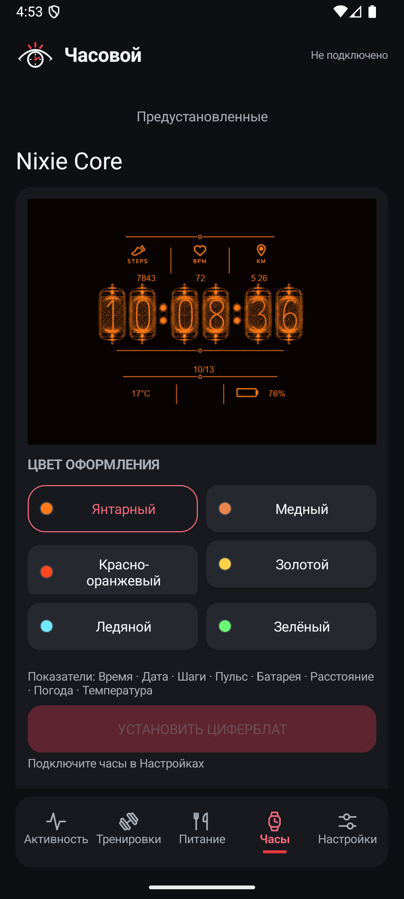
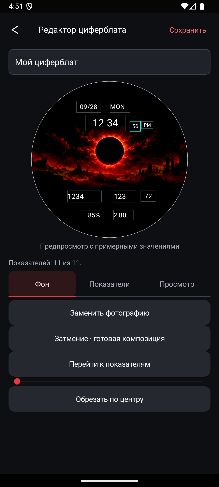
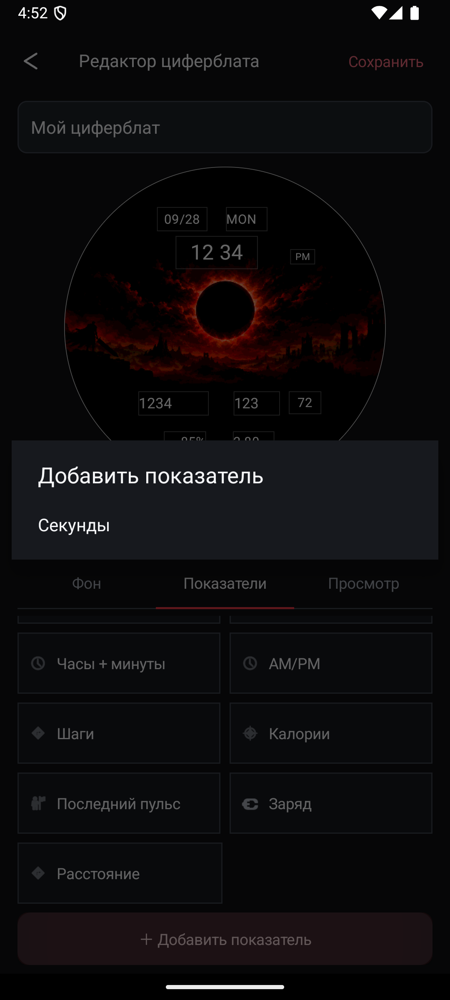
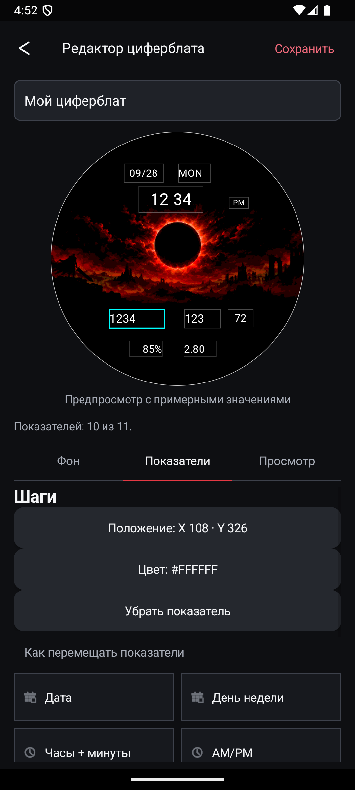
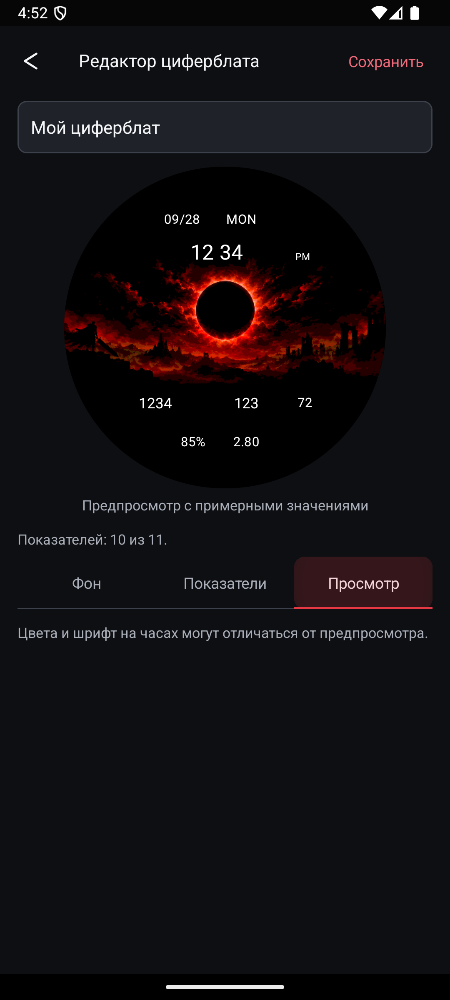

# Руководство пользователя

Инструкция относится к «Часовому» 1.0.0 и TECNO Watch GT/GT01. Часть названий может отображаться на английском при выборе языка приложения. Иллюстрации руководства сняты с debug-сборки 1.0.0 на чистом эмуляторе с тем же интерфейсом: числа в предпросмотре служат примерами, это не данные человека и не доказательство физической установки.

## Установка и подключение

1. Установите APK выбранного выпуска. Если Android запрашивает разрешение установки из этого источника, выдайте его конкретному приложению, которым открываете APK.
2. Для обновления поверх существующей установки необходим тот же сертификат подписи. При сообщении о несовместимой подписи не удаляйте приложение поспешно: сначала экспортируйте нужные проекты и записи.
3. Включите Bluetooth телефона и часов. Откройте «Настройки» и блок подключения часов.
4. Выдайте разрешение «Устройства поблизости»/Bluetooth. На старых Android для обнаружения может потребоваться местоположение. Дополнительные разрешения GPS-тренировки и уведомлений выдаются отдельно по необходимости.
5. Запустите поиск, выберите свои часы и дождитесь готового соединения. При отказе проверьте разрешения и доступность часов. Несколько одновременно работающих приложений управления часами могут мешать друг другу.

Для создания и редактирования проекта подключение к часам не требуется. Оно необходимо, когда вы нажимаете установку или получение данных.

## Выбор готового циферблата

Откройте вкладку «Часы», выберите категорию циферблатов и карточку. Если модель поддерживает палитры, выберите цвет в подробностях. Предпросмотр обновится, выбранный вариант запомнится на телефоне. Выбор цвета ещё не меняет экран часов — для этого нужна кнопка установки.

Нажмите «Установить циферблат» при готовом соединении. Следите за передачей и итогом операции. Не начинайте несколько установок одновременно. Завершение передачи, успешная установка и совпадение текущего циферблата — разные этапы; итоговое сообщение важнее одного процента на шкале.

После неуспеха операция заканчивается. Не считайте её автоматически отменённой на стороне часов: проверьте их экран и сохраните код ошибки. Новое нажатие — отдельная операция, которую стоит выполнять после выяснения состояния.

## Создание своего циферблата

### 1. Начните проект

На вкладке «Часы» откройте «Мои циферблаты» и создание нового проекта. Укажите понятное название, например «Учебный циферблат». Вверху находятся возврат и «Сохранить», ниже — круг предпросмотра и вкладки «Фон», «Показатели», «Просмотр».

Возврат сохраняет черновик для продолжения. Кнопка «Сохранить» создаёт сохранённую ревизию и возвращает в галерею. Для сохранения нужны фон, непустое название и хотя бы один показатель.

### 2. Выберите фон

На вкладке «Фон» нажмите «Заменить фотографию» и выберите изображение системным окном Android. Приложение применит поддерживаемую ориентацию изображения, сделает его непрозрачным и выберет центральный квадрат.

- Перетаскивайте изображение внутри круга, чтобы переместить обрезку.
- Ползунком увеличивайте изображение: диапазон от одного до четырёх раз.
- «Обрезать по центру» возвращает максимальный центральный квадрат.
- Перемещение фотографии не сдвигает уже поставленные показатели.
- «Затмение · готовая композиция» заменяет фон и расположение показателей готовым вариантом после подтверждения, если черновик уже заполнен. Используйте этот пункт только если он присутствует в выбранной комплектации выпуска.

Фотография должна укладываться в 20 МиБ и 16 миллионов пикселей. Если подготовка не удаётся или не хватает памяти, заранее уменьшите её разрешение. На Android ниже 11 некоторые PNG/WebP с EXIF-ориентацией требуют заранее применённого поворота; JPEG или уже правильно ориентированный файл обычно понятнее для этого сценария.

### 3. Добавьте показатели

Перейдите на вкладку «Показатели» и нажмите «＋ Добавить показатель». Список содержит ещё не добавленные типы. Один тип нельзя добавить дважды.

| Пункт | Что означает |
| --- | --- |
| Часы + минуты · общий блок | Часы и минуты перемещаются вместе; внутри проекта остаются двумя отдельными узлами. |
| Часы (HH), Минуты | Раздельные части времени. Их можно объединить позже. |
| Секунды | Добавляются отдельно, по желанию. |
| Дата, День недели, AM/PM | Дополнительные части отображения времени. |
| Шаги, Калории, Расстояние | Значения, доступные runtime часов; отсутствие данных не нужно считать нулём. |
| Последний пульс | Последнее сохранённое значение; это не непрерывное измерение. |
| Заряд | Уровень батареи часов. |

Всего доступно 11 типов. «Часы + минуты» занимает два типа из 11. Погода не является добавляемым текстовым показателем этого редактора. Если она нужна на циферблате, выберите соответствующую встроенную модель и отдельно настройте погодный сценарий.

### 4. Разместите и оформите

Нажмите показатель на круге или его кнопку в списке. Выделенный элемент можно двигать пальцем. При приближении рамки к соседней редактор помогает совместить края и центры. Весь прямоугольник должен оставаться внутри круглого экрана.

Для точности нажмите «Положение: X … · Y …», введите целые координаты и примените. `X` идёт слева направо, `Y` сверху вниз; это пиксели циферблата 466×466, а не пиксели телефона. При ошибке рамка не переносится за круг.

Через «Цвет: #…» задайте цвет в виде `#RRGGBB`, например `#FFFFFF` для белого или `#FFD700` для золотистого. Прозрачность текста не поддерживается. У общего блока часы и минуты получают одинаковый цвет; «Разделить часы и минуты» возвращает независимое размещение. Размеры полей и шрифт фиксированы профилем.

«Убрать показатель» удаляет выбранное поле из композиции. Если выбран общий блок времени, убираются обе его части. Чтобы вернуть поле, снова используйте добавление.

При оранжевых рамках прочитайте число перекрытий и разведите поля. Перекрытия не запрещены, но порядок на часах не гарантируется. Уменьшить рамку этого профиля нельзя.

### 5. Просмотрите и сохраните

Вкладка «Просмотр» показывает итог без редакторских рамок. Цвет фона уже приведён к палитре часов. Примерные цифры остаются примерными; шрифт физического устройства может выглядеть иначе.

Нажмите «Сохранить». Откройте сохранённый проект в «Моих циферблатах». Редактирование и повторное сохранение создают следующую ревизию, а «История изменений» позволяет открыть прежний вариант.

### 6. Подготовьте и установите

В карточке проекта нажмите «Подготовить для часов». Это локальная компиляция сохранённой ревизии в пакет GT01 с проверкой ресурсов и целостности. Во время подготовки часы не получают команд.

После подготовки появляется «Установить циферблат». Подключите часы, дождитесь готовности и нажмите кнопку. Обычный установщик передаёт выбранный пакет, устанавливает его, применяет и проверяет текущий циферблат. Он не делает новой полной резервной копии и не скачивает пакет обратно для побайтового сравнения.

Проверьте на часах фон, расположение, читаемость, время и каждый выбранный показатель. Новый проект может отличаться от того, который ранее проверялся разработчиком. Если поле пустое, сравните с доступностью соответствующего показателя часов; число в Android-предпросмотре не является доказательством наличия данных.

## Обмен проектами и пакетами

Меню «⋮» проекта предлагает доступные действия:

- «Поделиться проектом .gtdial» — редактируемый проект с исходным изображением, координатами и предпросмотром.
- «Поделиться готовым .dial» — уже подготовленный бинарный пакет; этот файл не является редактируемым проектом.
- «Архив для проверки .zip» — материалы конкретной компиляции. Проверьте содержимое перед передачей.
- «История изменений», редактирование и удаление проекта.

Для переноса редактируемого циферблата используйте `.gtdial`, затем «Импортировать проект .gtdial» в галерее. Импорт проверяет архив целиком и создаёт локальный проект. Произвольный внешний `.dial` не становится импортируемым проектом или автоматически разрешённым пакетом установки.

Экспорт `.gtdial` включает полное исходное изображение: части фотографии за кругом тоже попадут адресату. Удаление проекта на телефоне не удаляет уже установленный циферблат на часах.

## Экспорт показателей и перенос дневника питания

В «Настройках» откройте «Данные и приватность» → «Экспортировать показатели». Приложение создаёт JSON и предлагает поделиться файлом. Это экспорт для просмотра/анализа: пользовательского импорта этого JSON обратно в историю показателей в версии 1.0.0 нет. Он не является полной резервной копией приложения и не обещает восстановление после переустановки. Внутреннее чтение полученных от часов файлов служит синхронизации, а не импорту произвольного пользовательского отчёта.

Для питания откройте «Питание» → «Дневник и свои продукты». Здесь отдельно доступны «Экспорт дневника JSON» и «Импорт дневника JSON». Экспорт содержит продукты, записи и сведения о заполненности дней, без фото, URI и ключа OpenRouter. Импорт проверяет архив целиком: идентичные записи пропускаются, совпадающий ID с другими данными отменяет импорт полностью.

Экспорт отчёта анализа и диагностики служит передаче конкретного отчёта. Он не восстанавливает базу, тренировки, ключ или весь профиль. Перед переустановкой сохраните нужные проекты `.gtdial` и дневник питания через их отдельные маршруты; остальные выгрузки используйте как отчёты, не называя их восстанавливаемой копией.

## Уведомления

Если Android блокирует переключатель сообщением «Настройки с ограниченным доступом»:

1. Попробуйте включить доступ к уведомлениям и закройте предупреждение.
2. Откройте **Настройки телефона → Приложения → Часовой → сведения о приложении**.
3. Нажмите **⋮ → Разрешить настройки с ограниченным доступом**; при необходимости подтвердите действие разблокировкой телефона.
4. Вернитесь в «Часовой» и снова откройте системный доступ к уведомлениям. Разрешите его для «Часового», включите пересылку и выберите приложения.

Название и расположение системного пункта зависят от Android и оболочки телефона. Если ⋮ отсутствует, сначала вызовите предупреждение при попытке включения доступа. Установка через Google Play для этого способа не требуется. Выдавайте доступ только своей проверенной сборке: он позволяет приложению читать уведомления. Официальное описание: https://support.google.com/android/answer/12623953?hl=ru .

В настройках включите пересылку, откройте системное разрешение доступа к уведомлениям и выберите приложения. Проверяйте на новом входящем уведомлении, а не на старом сообщении в шторке. Постоянные уведомления, групповые сводки и уведомления самого «Часового» исключены.

Нужны готовое соединение с часами и работа фонового сервиса. Длинный заголовок/текст ограничивается безопасно по UTF-8; вся переписка не синхронизируется. Одинаковый текст за короткий период может быть подавлен. Выключение пересылки и отзыв системного доступа прекращают этот сценарий.

## Активность, тренировки, питание и OpenRouter

В активности проверяйте период, источник и время последнего наблюдения. Не заменяйте пустые дни нулями. Пульс, сон и SpO₂ не являются медицинским заключением; показатель «последний» не обозначает непрерывный поток.

Тренировки телефона и силовые записи ведутся локально. Для выбранной GPS-тренировки требуется местоположение и видимый фоновой сервис; пробелы маршрута после паузы/отказа разрешений остаются пробелами. Экспериментальный импорт спорта часов и управление их будильниками закрыты в обычной конфигурации. Полная работа тренировок и питания ещё требует проверки.

Для питания можно создать ручную запись или черновик по фото. Проверьте порцию, калории и БЖУ перед подтверждением: распознавание приблизительное. Для дополнительного анализа/фото нужен собственный ключ OpenRouter и выбранная совместимая модель в настройках. Данные уходят внешнему сервису только при соответствующем действии; модель может быть платной.

Если появляется `CONNECT`, `CONNECT_TIMEOUT`, `TLS`, `DNS`, `401` или другой код, сохраните точную категорию. Ошибка соединения не доказывает ошибку ключа. Известная проблема `CONNECT` остаётся открытой. Не отправляйте разработчику ключ или личные данные; для начала достаточно версии, кода и условий подключения.

## Частые затруднения

| Симптом | Что проверить |
| --- | --- |
| Нельзя сохранить | Название, готовый фон, хотя бы один показатель, рамки внутри круга. |
| Поле не добавляется | Оно уже присутствует; максимум один узел каждого типа. |
| Цвет фотографии изменился | Предпросмотр использует ограниченную палитру часов. |
| Установки нет в карточке проекта | Сначала сохраните ревизию и подготовьте пакет. |
| Кнопка установки неактивна | Готовность соединения, отсутствие другой операции и сообщение рядом с кнопкой. |
| Уведомление не дошло | Доступ Android, выбранное приложение, новое сообщение, соединение; постоянные/сводки исключаются. |
| Пустая история | Наличие записей и выбранный период/источник; отсутствие наблюдения не равно нулю. |
| APK не обновляется | `applicationId`, сертификат подписи и код версии выпуска. |

Сведения о форматах и точных пределах находятся в [WATCHFACE_AUTHORING.md](WATCHFACE_AUTHORING.md), о данных — в [PRIVACY.md](PRIVACY.md).

## Если поиск города или прогноз не загружается

Сообщение `Unable to resolve host` / `UnknownHostException` означает, что телефон не получил IP-адрес сервера. Это отличается от ошибки передачи прогноза по Bluetooth. Проверьте интернет, переключитесь между Wi-Fi и мобильной сетью; если настроен собственный «Частный DNS», попробуйте «Автоматически» и повторите обновление. Не меняйте циферблат и не сбрасывайте часы ради ошибки DNS.

В одном наблюдавшемся случае одновременно не разрешались адреса поиска города и всех трёх источников прогноза, тогда как местоположение и чтение с часов работали. Пользователь позднее подтвердил, что погода заработала после настройки подключения; точное изменение сети не зафиксировано, поэтому оно не объявляется универсальным исправлением.
